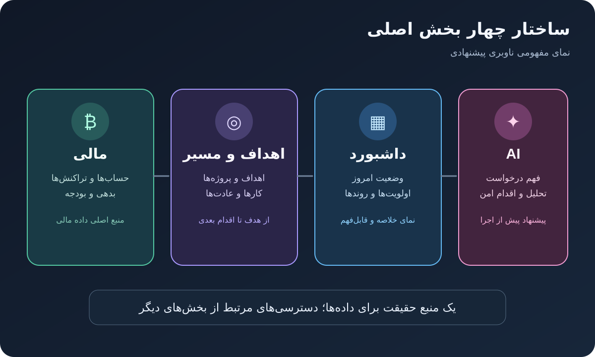
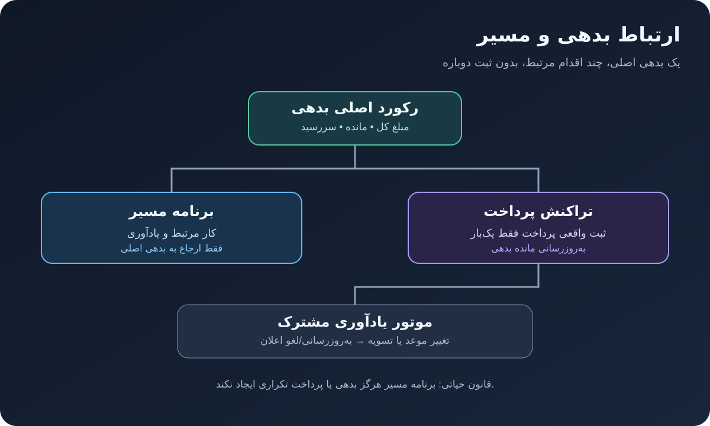
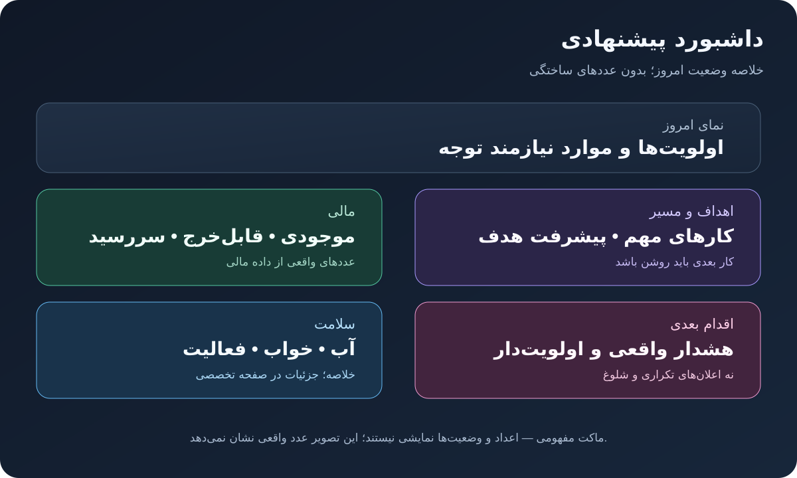
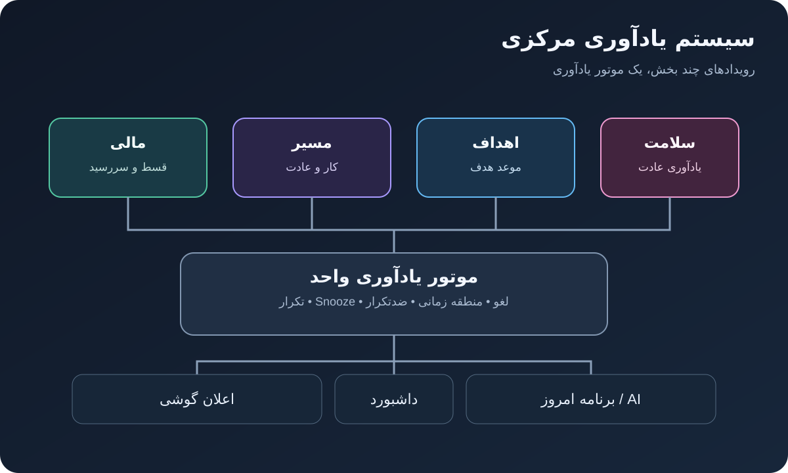

<div dir="rtl" align="center">

# 💎 Personal Life OS — Unified 4-Pillar Architecture & Liquid Glass Edition (v1.5.0R)
### سیستم‌عامل جامع مدیریت مالی، اهداف و مسیر، داشبورد وضعیت و دستیار هوشمند فارسی

[](./.github/workflows/android-apk.yml)
[](#)
[](./ROADMAP_PROGRESS.md)
[-A855F7?style=for-the-badge)](#طراحی-و-تم-liquid-glass)
[](#پایداری-و-رفع-کرش-روی-samsung-galaxy-s24-ultra-نسخه-v110)

</div>

---

<div dir="rtl">

## 📖 معرفی پروژه و اسناد معماری

**Personal Life OS** یک اپلیکیشن بومی اندروید (نوشته‌شده با **Kotlin** و **Jetpack Compose**) برای مدیریت یکپارچه **امور مالی، اهداف و مسیر، داشبورد وضعیت روزانه، سلامت و دستیار هوشمند فارسی** با پشتیبانی کامل از **زبان فارسی، تقویم جلالی (شمسی)، اعداد فارسی و واحد پولی تومان (و ارزهای بین‌المللی)** است.

این برنامه با معماری **Local-First (اول آفلاین)** طراحی شده است؛ یعنی بدون نیاز اجباری به اینترنت یا حساب کاربری، تمام اطلاعات شما روی حافظه امن گوشی (دیتابیس `Room v6` با مهاجرت‌های نسخه‌بندی‌شده `MIGRATION_1_2` تا `MIGRATION_5_6` + پشتیبان رمزنگاری‌شده `AES-256-GCM`) ذخیره می‌شود و در صورت ورود با حساب گوگل، به‌صورت خودکار و با صف ضدتکرار (`SyncQueueEntity` + Tombstone) با **Firebase Cloud Firestore** همگام‌سازی می‌گردد.

### 📚 اسناد رسمی نقشه راه و ممیزی فنی در مخزن:
- 🗺️ **[نقشه راه بازطراحی چهاربخشی (`APP_ROADMAP_FA.md`)](./APP_ROADMAP_FA.md):** سند مرجع معماری، قوانین دامنه مالی، اتصال بدهی به مسیر، موتور یادآوری مشترک و معیارهای پذیرش.
- 📋 **[فهرست جامع ممیزی قابلیت‌ها (`FEATURE_INVENTORY.md`)](./FEATURE_INVENTORY.md):** تطبیق خط‌به‌خط قابلیت‌ها، فایل‌ها، جداول دیتابیس و مسیرهای ناوبری.
- ✅ **[گزارش پیشرفت و نتایج تست (`ROADMAP_PROGRESS.md`)](./ROADMAP_PROGRESS.md):** گزارش اجرای فازهای صفر تا شش و نتایج واقعی ماتریس تست (`PASS`).
- 📝 **[تاریخچه تغییرات (`CHANGELOG.md`)](./CHANGELOG.md):** شرح کامل ویژگی‌های نسخه‌های `v1.0.0` تا `v1.5.0R`.
- 🔒 **[مشخصات امنیتی (`security_spec.md`)](./security_spec.md):** قوانین امنیتی Zero-Trust در Cloud Firestore و رمزنگاری داده‌ها.

---

## 📥 دانلود و نصب مستقیم فایل APK (از بخش Releases)

با هر بار Push شدن کد در مخزن گیت‌هاب، پایپ‌لاین خودکار **GitHub Actions** اجرا شده و دو نسخه APK در بخش **[Releases](../../releases)** منتشر می‌کند:

| نام فایل APK | کاربرد و ویژگی‌ها | پیشنهاد برای نصب |
| :--- | :--- | :--- |
| **`Personal-Life-OS-v1.5.0R-FinancePro-Debug.apk`** | امضاشده با کلید اصلی پروژه (دارای گواهی SHA-1 ثبت‌شده در Firebase برای ورود با گوگل / Google Sign-In) | ⭐ **پیشنهادی برای نصب روزمره و تست کامل قابلیت‌های ابری** |
| **`Personal-Life-OS-v1.5.0R-FinancePro-Release.apk`** | نسخه ریلیز امضاشده با کلید انتشار (`my-upload-key.jks`) برای توزیع عمومی | مناسب استفاده در حالت آفلاین/لوکال و انتشار |

### مراحل نصب روی گوشی (از جمله Samsung Galaxy S24 Ultra):
1. وارد بخش **[Releases](../../releases)** در همین مخزن گیت‌هاب شوید.
2. آخرین نسخه (`v1.5.0R`) را باز کرده و فایل **`Personal-Life-OS-v1.5.0R-FinancePro-Debug.apk`** را دانلود کنید.
3. فایل را روی گوشی باز کرده و گزینه **Install / Update** را بزنید (به دلیل ارتقای `versionCode = 6` و مهاجرت غیرمخرب `MIGRATION_5_6`، بدون نیاز به حذف نسخه قبلی و با حفظ تمام داده‌ها مستقیماً آپدیت می‌شود).

---

## 🧭 معماری چهاربخشی برنامه (نسخه `v1.5.0R`)

ساختار ناوبری برنامه بر اساس چهار ستون اصلی منوی پایین سازمان‌دهی شده است تا هر قابلیت یک منبع حقیقت واحد (`Single Source of Truth`) داشته باشد:



| ترتیب در منوی پایین | عنوان بخش | کلید مسیر (`Route`) | مسئولیت اصلی |
| :---: | :--- | :--- | :--- |
| **۱** | **مالی** | `DAILY_LOG` | حساب‌ها، درآمد و هزینه، انتقال بین حساب‌ها، بدهی و اقساط، اسکنر پیامک بانکی، بودجه Safe-to-Spend و گزارش مالی |
| **۲** | **اهداف و مسیر** | `GOALS_AND_HABITS` | اهداف، تسک‌ها (همراه با برنامه بازپرداخت اقساط بدهی)، عادت‌های روزانه، تایمر تمرکز پومودورو و زیربخش سلامت (آب، کالری، خواب، ورزش) |
| **۳** | **داشبورد** | `HOME` | خلاصه وضعیت امروز، کارت یادآوری‌های مهم و اقدام بعدی، شاخص‌های واقعی در برابر تخمینی و شخصی‌سازی نمایش کارت‌ها |
| **۴** | **AI** | `AI_ASSISTANT` | گفت‌وگوی فارسی، تبدیل گفتار به متن آفلاین/آنلاین، پرسش تکمیلی در ابهام، تحلیل مبتنی بر داده واقعی و اجرای کنترل‌شده با تأیید کاربر |

---

### ۱. 💳 بخش اول: مالی (`DailyLogAndHealthScreen`)
- **ساختار ۲ تبی تخصصی:**
  1. **«ورودی و خروجی‌ها»:** ثبت و پایش درآمد، هزینه و **انتقال بین حساب‌های شخصی (`TRANSFER`)** در بازه‌های روزانه، هفتگی، ماهانه و سالانه. *(انتقال بین حساب‌های خود کاربر باعث ایجاد درآمد یا هزینه مصنوعی نمی‌شود).*
  2. **«طلب و بدهی و برنامه اقساط»:** مدیریت بدهی‌ها (`DEBT`) و مطالبات (`RECEIVABLE`) با نمایش **مبلغ کل، مبلغ پرداخت‌شده (`paidAmount`) و مانده فعلی (`remainingAmount`)**، ثبت پرداخت جزئی/قسط با کلید یکتای ضدتکرار (`idempotencyKey`) و تسویه کامل.
- **اسکنر هوشمند پیامک‌های بانکی ایران (`BankSmsScannerUtility` + `READ_SMS`):**
  - خواندن پیامک‌های بانکی با مجوز زمان اجرا، فیلتر کردن خودکار پیامک‌های رمز پویا (`OTP`)، تشخیص ۱۷ بانک ایرانی، تبدیل خودکار **ریال به تومان (÷ ۱۰)**، تشخیص پذیرنده/دسته‌بندی، جلوگیری از ثبت تکراری و نمایش پیش‌نمایش قبل از ثبت.
- **دکمه‌های ثبت سریع ۱-لمسی (`1-Tap Presets`) و دسته‌بندی‌های سفارشی.**
- **موتور بودجه امن روزانه (`Safe-to-Spend`) + پشتیبانی چندارزی (تومان، دلار، یورو، درهم، ریال) + خروجی اکسل (`CSV`).**

---

### ۲. 🎯 بخش دوم: اهداف و مسیر + اتصال مستقیم به بدهی‌ها (`GoalsAndHabitsCombinedScreen`)



- **اتصال یکپارچه مالی و مسیر (`Debt-to-Goal Link`):**
  - امکان ساخت **برنامه بازپرداخت اقساط (`createDebtRepaymentPlan`)** برای هر بدهی؛ تسک‌های اقساط در بخش «اهداف و مسیر» با فیلد `linkedDebtId` به رکورد اصلی بدهی در بخش مالی ارجاع می‌دهند بدون اینکه بدهی تکراری بسازند.
  - تیک‌زدن ساده یک تسک به‌تنهایی پرداخت مالی ثبت نمی‌کند؛ پرداخت واقعی قسط از طریق `recordDebtInstallmentPayment` دقیقاً یک‌بار ثبت شده، مانده بدهی را کاهش می‌دهد و تسک مرتبط را تکمیل می‌کند.
  - با تسویه کامل بدهی، تمامی تسک‌های بازپرداخت مرتبط به‌صورت خودکار بسته (`COMPLETED`) و یادآوری‌های آینده آن‌ها لغو می‌شوند.
- **زیربخش‌های سه‌گانه در «اهداف و مسیر»:**
  1. **اهداف و تسک‌ها:** اولویت‌بندی، ماتریس آیزنهاور، زیرتسک‌ها، تسک‌های تکرارشونده و تغییر موعد کنترل‌شده.
  2. **عادت‌ها و تمرکز:** پیگیری زنجیره تداوم عادت‌ها (`Habit Streak`)، ماتریس ۷ روزه و تایمر فوکوس/پومودورو شناور.
  3. **سلامت و روتین:** پایش آب با موج زنده (`AnimatedWaterWaveBox`)، کالری‌شمار و تغذیه، ثبت خواب (`SleepRecord`) و ورزش (`ExerciseRecord`).

---

### ۳. 📊 بخش سوم: داشبورد وضعیت امروز (`HomeDashboardScreen`)



- **پاسخ سریع به «الان چه وضعیتی دارم و اقدام مهم بعدی چیست؟»:**
  - **کارت «یادآوری‌های مهم و اقدام بعدی»:** نمایش متمرکز تسک‌های عقب‌افتاده، اولویت‌های امروز و نزدیک‌ترین سررسید بدهی/قسط.
  - **تفکیک صریح داده واقعی، تخمینی و ناموجود:**
    - در صورت نبود رکورد برای یک شاخص، به‌جای عدد گمراه‌کننده `0`، عبارت **«داده کافی نیست»** نمایش داده می‌شود.
    - پیش‌بینی مخارج تا پایان ماه با برچسب صریح **«برآورد هزینه پایان ماه (تخمینی)»** از داده‌های قطعی تفکیک شده است.
  - **شخصی‌سازی کارت‌های داشبورد (`dashboard_customize_cards_button`):** امکان نمایش یا مخفی کردن کارت‌های داشبورد توسط کاربر با ذخیره پایدار در تنظیمات.
  - **ناوبری ۱-لمسی:** هر کارت خلاصه مستقیماً کاربر را به صفحه تخصصی همان قابلیت هدایت می‌کند.

---

### ۴. 🎙️ بخش چهارم: دستیار هوشمند فارسی و ورودی صوتی آفلاین/آنلاین (`AiAssistantScreen` & `VoiceCaptureSheet`)
- **تبدیل گفتار به متن فارسی با پشتیبانی آفلاین (`PersianOfflineSpeechHelper`):**
  - تشخیص خودکار وضعیت بسته‌های صوتی آفلاین روی دستگاه (`EXTRA_PREFER_OFFLINE`)، راهنمای نصب بسته فارسی (`fa-IR`) برای کارکرد بدون اینترنت، و درک مبالغ محاوره‌ای تومان (مثلاً «۵۰۰ تومن» ⬅ `۵۰۰,۰۰۰ تومان`).
- **اجرای کنترل‌شده و ایمن (`Controlled AI Execution`):**
  - **پرسش تکمیلی در درخواست‌های مبهم (`AskClarification`):** اگر کاربر بگوید «بدهی رو تسویه کن» یا «هزینه ثبت کن» بدون مشخص کردن مبلغ یا عنوان، دستیار به‌جای ثبت حدسی، سؤال تکمیلی می‌پرسد و گزینه‌های موجود را نمایش می‌دهد.
  - **پاسخ‌های تحلیلی متکی به داده واقعی و بازه زمانی مشخص:** پاسخ به سوالاتی مانند *«این ماه بیشترین هزینه‌ام برای چی بوده؟»*، *«وضعیت بدهی و اقساطم چطوره؟»* یا *«روند عادت‌هام در هفته اخیر چطور بوده؟»* مستقیماً از دیتابیس واقعی و با ذکر دقیق بازه زمانی (`۳۰ روز اخیر` / `۷ روز اخیر`) استخراج می‌شود.
  - **پیش‌نمایش و الزام تأیید (`requiresConfirmation = true`):** هیچ عملیات مالی یا تغییری بدون تأیید صریح کاربر روی کارت پیش‌نمایش در دیتابیس ثبت نمی‌شود.

---

### ۵. 🔔 موتور یادآوری مشترک (`Unified Reminder Engine`)



- **یک موتور واحد (`ReminderScheduler` در `ReminderReceiver.kt`) برای تمام بخش‌ها:**
  - پشتیبانی یکپارچه از رویدادهای `TASK` (کارها)، `DEBT` (سررسید بدهی و قسط)، `HABIT` (عادت‌ها)، `GOAL` (اهداف) و `DAILY_EXPENSE` (یادآور روزانه ثبت هزینه‌ها در ساعت دلخواه شبانه‌روز).
  - **سیاست ضدتکرار و کلید یکتا:** تولید شناسه یکتا بر اساس `(entityType, entityId)`؛ تغییر موعد کار یا بدهی (`rescheduleEntityReminder`) آلارم قبلی را لغو و زمان جدید را جایگزین می‌کند.
  - **پشتیبانی از `Snooze` بدون تکثیر اعلان** و **لغو خودکار (`cancelEntityReminder`)** به محض تکمیل کار یا تسویه کامل بدهی.
  - **حفاظت از حریم خصوصی (`hideSensitiveContent`):** امکان پنهان‌کردن مبالغ و عناوین حساس مالی روی اعلان‌های صفحه قفل.

---

## 🎨 طراحی و تم Liquid Glass

رابط کاربری برنامه بر پایه سیستم طراحی **Multi-Layered Liquid Glass** پیاده‌سازی شده است:
- **`LiquidGlassBackdrop`:** پس‌زمینه عمیق ابسیدین (`#050811`) همراه با گوی‌های نوری حجمی و پشتیبانی از تم روشن/تاریک (`Daylight & Obsidian Mode`).
- **`LiquidGlassCard` و `GlassSurface`:** کارت‌های شیشه‌ای با کنتراست بهینه‌شده برای خوانایی بالا در زبان فارسی و چیدمان راست‌به‌چپ (`RTL`).
- **`GlassBottomSheetContainer` و `GlassDialogContainer`:** شیت‌ها و دیالوگ‌های یکپارچه شیشه‌ای.

---

## 🛡️ پایداری و رفع کرش روی Samsung Galaxy S24 Ultra (نسخه `v1.1.0` به بعد)

تمامی مشکلات و کرش‌های گزارش‌شده روی پرچم‌دار **Samsung Galaxy S24 Ultra** (نمایشگر `xxxhdpi` / 505 PPI و رندرر Vulkan/Skia) به‌صورت ریشه‌ای برطرف شده‌اند:
1. **مقداردهی اولیه ضدکرش Firebase (`ensureFirebaseInitialized`):** کارکرد ۱۰۰٪ بدون کرش در حالت آفلاین و بیلدهای مستقل گیت‌هاب.
2. **ایمن‌سازی شیدرهای گرافیکی `RadialGradient`:** اعمال گارد بررسی ابعاد و `.coerceAtLeast(1f)` برای جلوگیری از خطای `radius must be > 0`.
3. **ایمن‌سازی بازه `coerceIn` در موج صوتی (`VoiceCaptureSheet`)** و محافظت کامل از `CredentialManager` و `SpeechRecognizer`.

---

## 🏗️ معماری فنی و ساختار پروژه

```text
├── APP_ROADMAP_FA.md                   # سند رسمی نقشه راه بازطراحی چهاربخشی (همراه با دیاگرام‌های SVG)
├── FEATURE_INVENTORY.md                # فهرست ممیزی قابلیت‌ها، محل فعلی/مقصد و وضعیت ریسک (فاز صفر)
├── ROADMAP_PROGRESS.md                 # گزارش پیشرفت فازهای ۰ تا ۶ و نتایج ماتریس ۱۲ گانه تست
├── CHANGELOG.md                        # تاریخچه کامل تغییرات نسخه‌ها (v1.0.0 تا v1.4.0)
├── images/                             # دیاگرام‌های معماری (navigation-map, debt-goal-link, dashboard, reminder)
├── .github/workflows/
│   └── android-apk.yml                 # پایپ‌لاین CI/CD ساخت خودکار APK و انتشار در GitHub Releases
├── app/src/main/java/com/example/
│   ├── MainActivity.kt                 # نقطه ورود اصلی، نوار ناوبری ۴ بخشی و حفظ Deep Linkها
│   ├── ai/
│   │   └── GeminiAssistantService.kt   # موتور هوش مصنوعی کنترل‌شده، تشخیص ابهام و تحلیلگر فارسی
│   ├── data/
│   │   ├── firebase/
│   │   │   └── AppCheckAndAuth.kt      # راه‌اندازی ایمن Firebase، AppCheck و احراز هویت گوگل
│   │   ├── local/
│   │   │   ├── LifeOsDatabase.kt       # دیتابیس محلی Room (نسخه ۶ با MIGRATION_1_2 تا MIGRATION_5_6)
│   │   │   └── PreferencesDataStore.kt # ذخیره تنظیمات، ترتیب کارت‌های داشبورد و ساعت یادآور روزانه
│   │   ├── model/
│   │   │   └── LifeOsModels.kt         # مدل‌های دامنه (Task با linkedDebtId، DebtItem با paidAmount، TRANSFER و...)
│   │   └── repository/
│   │       └── LifeOsRepository.kt     # مخزن داده Local-First + اتصال بدهی به مسیر + سینک ضدتکرار
│   ├── notifications/
│   │   ├── LifeOsQuickWidgetProvider.kt# ویجت صفحه اصلی اندروید
│   │   ├── QuickVoiceTileService.kt    # کاشی تنظیمات سریع (Quick Settings Tile) برای ثبت صوتی
│   │   └── ReminderReceiver.kt         # موتور یادآوری مشترک (TASK, DEBT, HABIT, GOAL, DAILY_EXPENSE) + Snooze
│   ├── ui/
│   │   ├── components/                 # کامپوننت‌های ماژولار شیشه‌ای و نمودارهای تحلیلی
│   │   ├── screens/                    # صفحات اصلی (مالی، اهداف و مسیر، داشبورد، AI، گزارش‌ها، تنظیمات)
│   │   ├── theme/                      # سیستم طراحی Liquid Glass
│   │   └── viewmodel/
│   │       └── LifeOsViewModel.kt      # مدیریت یکپارچه StateFlowها و منطق تجاری رابط کاربری
│   └── util/
│       ├── BankSmsScannerUtility.kt    # پارسر پیامک‌های بانکی ایران با فیلتر OTP و تشخیص ۱۷ بانک
│       ├── PersianOfflineSpeechHelper.kt # مدیریت تبدیل گفتار به نوشتار فارسی در حالت آفلاین و آنلاین
│       ├── PersianDateAndUnitUtils.kt  # مبدل تاریخ شمسی (جلالی)، اعداد فارسی و نرمال‌ساز تومان/ریال
│       └── WorldClassOsUtils.kt        # موتور بودجه امن، شاخص‌های داشبورد و بکاپ رمزنگاری‌شده AES-256-GCM
└── firestore.rules                     # قوانین امنیتی Zero-Trust دیتابیس Cloud Firestore
```

---

## ⚙️ راهنمای بیلد محلی و اجرای تست‌ها

### پیش‌نیازها
- **JDK 17** | **Android SDK 36** | **Gradle 9.3.1**

### دستورات بیلد و تست
1. برای بیلد کردن نسخه‌های Debug و Release:
   ```bash
   gradle assembleDebug assembleRelease
   ```
2. برای اجرای تست‌های واحد و ماتریس تست Robolectric (شامل تمام فازهای نقشه راه):
   ```bash
   gradle :app:testDebugUnitTest --tests "com.example.ExampleRobolectricTest"
   ```

</div>
